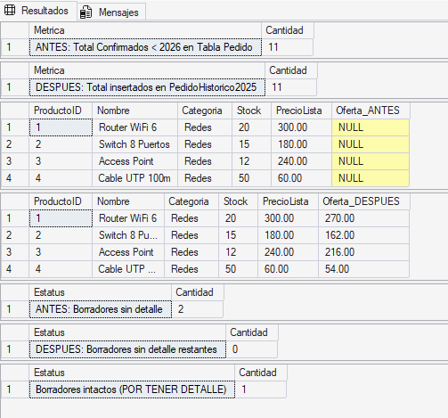
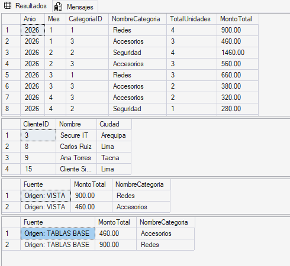

# 🛒 Proyecto NovaMarket - Evaluación Aplicada (PA2)


**Curso:** 30627 - Programación Avanzada de Base de Datos  
**Institución:** ISIL  
**Docente:** Wilder Julio Espinoza Bravo  
**Enlace al Repositorio en GitHub:** [GitHUB GRUPO 3](https://github.com/GustavoRonaldinho67/Programacion-Avanzada-DB-PA2)

---

## 👥 Equipo de Desarrollo y Roles

| Integrante                      | Usuario GitHub                                                 | Rol / Actividad Asignada                                                                                                           |
| :------------------------------ | :------------------------------------------------------------- | :--------------------------------------------------------------------------------------------------------------------------------- |
| **Gustavo Muñoz Izquierdo**     | [@GustavoRonaldinho67](https://github.com/GustavoRonaldinho67) | **Dev S04:** Subconsultas, lógica de segmentación (`EXISTS`) y análisis de precios relativos.                                      |
| **Leandro Henostroza Minaya**   | [@Lenvisual](https://github.com/Lenvisual)                     | **Dev S05:** Mantenimiento controlado (DML), protección de registros y actualizaciones idempotentes.                               |
| **Fernando Alcantara Valencia** | [@totomanxd321](https://github.com/totomanxd321)               | **Dev S06:** Vistas SQL, encapsulamiento de lógica de negocio y contraste de métricas.                                             |
| **Victor Aguilar de la Cruz**   | [@victordaniel2032](https://github.com/victordaniel2032)       | **Dev S07:** Generación volumétrica masiva, funciones de aleatoriedad y reportes analíticos con CTEs.                              |
| **Mauricio Rojas Arias**        | [@chunchope](https://github.com/chunchope)                     | **QA & Code Review:** Consolidación de scripts, auditoría de restricciones lógicas, pruebas de casos límite y despliegue continuo. |

---

## 🏢 Contexto del Caso: NovaMarket

NovaMarket es una tienda de tecnología especializada en Redes, Seguridad y Accesorios. La alta gerencia requiere respuestas transaccionales y analíticas basadas en SQL avanzado.

Este proyecto resuelve problemáticas reales exigidas en la rúbrica como: segmentación estricta de marketing evitando falsos positivos, creación de históricos de ventas, publicación de ofertas sin acumulación de descuentos anómalos, limpieza de datos huérfanos y generación de reportes de rentabilidad blindados contra duplicidades (productos cartesianos).

---

## 📂 Estructura del Repositorio

Para cumplir con las exigencias de revisión, el proyecto está estructurado de la siguiente manera:

```text
/
├── README.md                                 # Documentación técnica (Este archivo)
├── /sql/
│   ├── 00_esquema_y_datos_base.sql           # DDL y carga de catálogos
│   ├── 01_subconsultas_s04.sql               # Actividad S04 (Gustavo)
│   ├── 02_mantenimiento_s05.sql              # Actividad S05 (Leandro)
│   ├── 03_vistas_s06.sql                     # Actividad S06 (Fernando)
│   ├── 04_datos_de_prueba_y_volumetria.sql   # Actividad S07-A (Victor)
│   └── 05_reporte_definitivo_s07.sql         # Actividad S07-B (Integración QA - Mauricio)
└── /evidencias/                              # Capturas de pantalla de resultados en SSMS
    ├── S05_Validacion_Update_Antes_Despues.png
    ├── S06_Contraste_Vistas_Vs_Tablas.png
    └── S07_Matriz_Pruebas_Reporte_Ceros.png
```

---

## ⚙️ Requisitos y Guía de Despliegue

### Entorno Requerido

- **Motor:** Microsoft SQL Server (2012 o superior).
- **IDE:** SQL Server Management Studio (SSMS) o Azure Data Studio.

### Orden Estricto de Ejecución

Para garantizar la integridad referencial y el flujo de los datos, los scripts deben ejecutarse **exactamente en este orden**. Los scripts han sido diseñados con cláusulas de protección (`IF OBJECT_ID`, `NOT IN`) que permiten su ejecución repetida sin generar errores fatales.

1. `00_esquema_y_datos_base.sql`
2. `01_subconsultas_s04.sql`
3. `02_mantenimiento_s05.sql`
4. `03_vistas_s06.sql`
5. `04_datos_de_prueba_y_volumetria.sql`
6. `05_reporte_definitivo_s07.sql`

---

## 🔬 Resultados y Decisiones Técnicas

### 📌 S04: Subconsultas y Segmentación (Gustavo)

- **Decisión Técnica:** Se descartó el uso de `NOT IN` para evitar fallos catastróficos por **lógica trivaluada** (si la subconsulta retorna un `NULL`, el bloque entero evalúa como `UNKNOWN` y rechaza todas las filas válidas). Se implementó `EXISTS` / `NOT EXISTS`, logrando un _cortocircuito lógico_ seguro y altamente eficiente.
- **Análisis de Casos de Prueba (Validación S04.A):**
  - _Caso Positivo (Cliente 1):_ Tiene compras confirmadas de 'Redes' y ninguna de 'Seguridad' en 2026. Es incluido en el resultado correctamente.
  - _Caso Negativo (Cliente 2):_ Tiene compras de 'Redes', pero también de 'Seguridad'. La condición `NOT EXISTS` detecta la infracción y lo excluye del reporte.

### 📌 S05: Mantenimiento Controlado DML (Leandro)

- **Explicación de Filtros y Decisiones (Idempotencia):** Se previno que los scripts de migración rompan la DB si se ejecutan múltiples veces (F5 accidental).
  - **Filtro INSERT (Histórico):** `FechaPedido < '2026-01-01' AND Estado = 'CONFIRMADO'`. Se validó con `NOT IN (SELECT PedidoID FROM PedidoHistorico2025)` para evitar duplicados.
  - **Filtro UPDATE (Precios):** Se condicionó explícitamente `p.PrecioOferta <> ROUND(p.PrecioLista * 0.90, 2)` para evitar aplicar descuentos acumulativos de forma destructiva (20%, 30%).
  - **Filtro DELETE (Limpieza):** `NOT EXISTS (SELECT 1 FROM DetallePedido...)` elimina de forma segura solo las cabeceras huérfanas en estado `BORRADOR` sin afectar el historial transaccional.

**📸 Evidencia de ejecución (Antes y Después):**  


### 📌 S06: Vistas y Reutilización (Fernando)

- **Decisión Técnica:** Se encapsularon los JOINs masivos en `vw_VentasCategoriaMes`. Esto abstrae la complejidad, estandariza la regla comercial (`Estado = 'CONFIRMADO'`) y previene errores en conexiones desde herramientas de BI.
- **Comando de prueba reproducible:**

```sql
  SELECT * FROM vw_VentasCategoriaMes WHERE Anio = 2026 ORDER BY Mes ASC;
```

**📸 Evidencia de contraste (Vista vs Tablas base):**  


### 📌 S07: Volumetría y Reporte Analítico (Victor)

- **Decisión Técnica (Volumetría):** Para inyectar más de 200 pedidos sin usar bucles ineficientes (`WHILE`), se utilizó un `CROSS JOIN` sobre `sys.all_objects` combinado con `CHECKSUM(NEWID())` y `CHOOSE()`. Esto inyecta entropía real (fechas, canales y estados aleatorios) respetando la integridad referencial estricta.
- **Esquema de Salida Obligatorio:** Se cumplió con el formato exacto exigido en la rúbrica: `ClienteID | Nombre | TotalPedidos2026 | MontoVendido2026`.

---

## 🛡️ Matriz de Pruebas y Validación (QA - Mauricio)

Como requerimiento de calidad y contraste independiente, se diseñó la consulta del Reporte Definitivo utilizando una **CTE (Common Table Expression)**. Esto agrupó los pedidos en una primera fase, evitando que un simple `COUNT(PedidoID)` contara erróneamente líneas de detalle múltiples como si fueran pedidos distintos (producto cartesiano).

| Escenario Límite Evaluado       | Identificador | Condición                                                  | Resultado Esperado                         | Resultado Obtenido (QA)           | Conclusión Técnica                                                                       |
| :------------------------------ | :------------ | :--------------------------------------------------------- | :----------------------------------------- | :-------------------------------- | :--------------------------------------------------------------------------------------- |
| **1. Multiplicidad Cartesiana** | Cliente 1     | Tiene 1 pedido pero con 3 líneas de detalle.               | Pedidos = 1 <br> Monto = Sumatoria exacta. | ✅ OK (Pedidos: 1, Monto: 720.00) | La CTE evitó que los 3 detalles se contaran como 3 pedidos distintos.                    |
| **2. Cliente Sin Compras**      | Cliente 3     | Registrado en DB, solo tiene un pedido en estado Borrador. | Pedidos = 0 <br> Monto = 0.00              | ✅ OK (Pedidos: 0, Monto: 0.00)   | El uso de `LEFT JOIN` y `COALESCE(..., 0)` trató los `NULL` aritméticos de forma segura. |
| **3. Falsos Positivos**         | Cliente 9     | Tiene pedidos, pero su estado es `PENDIENTE`.              | Pedidos = 0 <br> Monto = 0.00              | ✅ OK (Pedidos: 0, Monto: 0.00)   | El filtro `Estado = 'CONFIRMADO'` en la CTE purga los no válidos antes del Join.         |
| **4. Filtro Temporal**          | Cliente 8     | Sus compras confirmadas ocurrieron en 2025.                | Pedidos = 0 <br> Monto = 0.00              | ✅ OK (Pedidos: 0, Monto: 0.00)   | La condición SARGable `>= '20260101'` omite el conteo pero preserva al cliente activo.   |

**📸 Evidencia de la Matriz de Pruebas Automatizada (QA):**  


---

_Desarrollado con rigor técnico para la evaluación PA2 - 2026._
