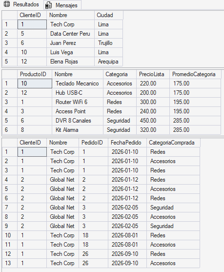
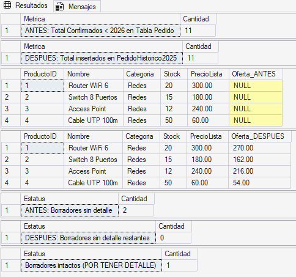
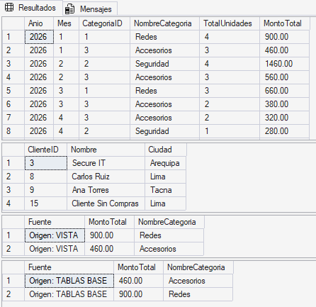
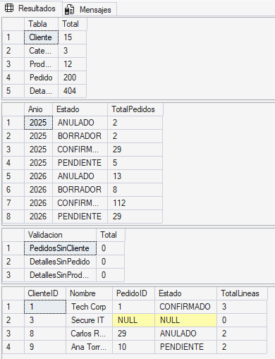
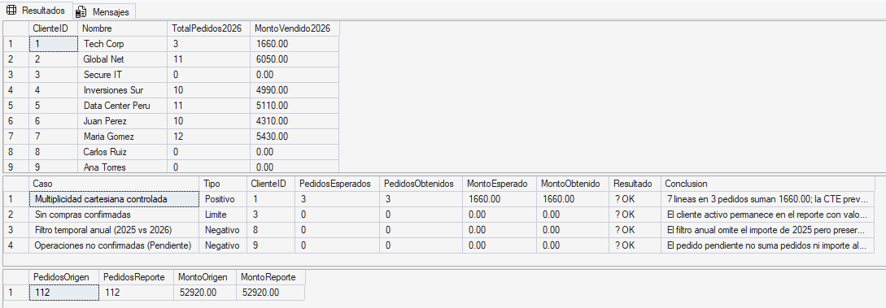

# 🛒 Proyecto NovaMarket - Evaluación Aplicada (PA2)


**Curso:** 30627 - Programación Avanzada de Base de Datos  
**Institución:** ISIL - Educación Superior  
**Docente:** Wilder Julio Espinoza Bravo  
**Enlace al Repositorio en GitHub:** [GitHUB GRUPO 3](https://github.com/GustavoRonaldinho67/Programacion-Avanzada-DB-PA2)

---

## 👥 Equipo de Desarrollo y Roles

| Integrante                      | Usuario GitHub                                                 | Rol / Actividad Asignada                                                                                                           |
| :------------------------------ | :------------------------------------------------------------- | :--------------------------------------------------------------------------------------------------------------------------------- |
| **Gustavo Muñoz Izquierdo**     | [@GustavoRonaldinho67](https://github.com/GustavoRonaldinho67) | **Dev S04:** Subconsultas, segmentación excluyente (`EXISTS` / `NOT EXISTS`) y análisis de precios relativos.                      |
| **Leandro Henostroza Minaya**   | [@Lenvisual](https://github.com/Lenvisual)                     | **Dev S05:** Mantenimiento controlado DML, idempotencia, preservación histórica y depuración segura.                               |
| **Fernando Alcantara Valencia** | [@totomanxd321](https://github.com/totomanxd321)               | **Dev S06:** Vistas SQL, encapsulamiento de reglas comerciales y verificación cruzada de métricas.                                 |
| **Victor Aguilar de la Cruz**   | [@victordaniel2032](https://github.com/victordaniel2032)       | **Dev S07:** Generación masiva de volumetría con recursividad y reporte analítico con CTEs.                                        |
| **Mauricio Rojas Arias**        | [@chunchope](https://github.com/chunchope)                     | **QA & Code Review / Integración:** Auditoría de integridad, pruebas automatizadas, control de casos límite y despliegue continuo. |

---

## 🏢 Contexto de Negocio y Arquitectura del Caso

NovaMarket es una compañía tecnológica orientada al retail de productos de **Redes**, **Seguridad** y **Accesorios**. La gerencia comercial requiere un modelo de base de datos relacional y analítico robusto que permita:

1. Segmentar clientes en base a comportamientos de compra específicos sin incurrir en duplicaciones.
2. Ejecutar rutinas DML seguras (migraciones históricas, listas de ofertas y depuración de registros en borrador) sin riesgo de corrupción de datos ante ejecuciones accidentales múltiples.
3. Centralizar reglas de negocio mediante capas lógicas (Vistas) para consumo seguro de herramientas de BI.
4. Generar volumetría realista superior a 200 pedidos y 400 líneas de detalle asegurando la integridad referencial.
5. Elaborar un reporte anualizado de rendimiento por cliente protegido contra el error de multiplicidad cartesiana (detalles inflando el conteo de cabeceras).

---

## 📂 Estructura Oficial del Repositorio

Cumpliendo con la estructura recomendada en la rúbrica (Sección 3.2):

```text
/
├── README.md                                 # Documentación técnica y sustentación (Este archivo)
├── /sql/
│   ├── 00_esquema_y_datos_base.sql           # DDL y carga de catálogos y transacciones base
│   ├── 01_s04_subconsultas.sql               # Actividad S04 (Gustavo)
│   ├── 02_s05_mantenimiento.sql              # Actividad S05 (Leandro)
│   ├── 03_s06_vistas.sql                     # Actividad S06 (Fernando)
│   ├── 04_s07_datos_prueba.sql               # Actividad S07-A (Victor)
│   └── 05_s07_reporte_clientes.sql           # Actividad S07-B (Integración QA - Mauricio)
└── /evidencias/                              # Directorio de evidencias gráficas obligatorias
    ├── 01_s04_subconsultas.png
    ├── 02_s05_mantenimiento.png
    ├── 03_s06_vistas.png
    ├── 04_s07_datos_prueba.png
    └── 05_s07_reporte_clientes.png
```

---

## ⚙️ Guía de Despliegue y Secuencia de Ejecución

### Requisitos Técnicos
- **Motor:** Microsoft SQL Server (2012, 2016, 2019, 2022 o Azure SQL Database).
- **Entorno de Trabajo:** SQL Server Management Studio (SSMS) o Azure Data Studio.

### Orden Estricto de Ejecución
Los scripts se estructuran modularmente para garantizar la integridad referencial. Deben compilarse en la siguiente secuencia en el IDE (asegurándose de que cada uno finalice sin errores antes de pasar al siguiente):

1. `00_esquema_y_datos_base.sql` (Crea el contexto `NovaMarket` y lo selecciona).
2. `01_s04_subconsultas.sql`
3. `02_s05_mantenimiento.sql`
4. `03_s06_vistas.sql`
5. `04_s07_datos_prueba.sql`
6. `05_s07_reporte_clientes.sql`

---

## 🔬 Sustento Técnico de Decisiones y Análisis por Actividad

### 📌 Actividad 1 (Sesión 04) - Subconsultas y Segmentación (Gustavo)
* **Justificación de `EXISTS` frente a `NOT IN`:** `EXISTS` evalúa la condición bajo el principio de *cortocircuito lógico*; tan pronto encuentra la primera tupla coincidente, interrumpe el escaneo y retorna `TRUE`. En contraste, `NOT IN` es vulnerable a la lógica trivaluada de SQL: si la subconsulta evalúa un solo registro `NULL`, toda la expresión se evalúa como `UNKNOWN`, provocando que el motor descarte el 100% de los registros válidos.
* **Cálculo de Precios Relativos (Promedio):** En la consulta 1B, el promedio no es global, sino categórico. Esto se logró utilizando una subconsulta correlacionada en el `SELECT`, vinculando `p2.CategoriaID = p.CategoriaID`. Así, la función de agregación `AVG()` se calcula dinámicamente sobre la categoría específica del producto evaluado en el bloque externo.
* **Análisis de Casos de Prueba (Validación S04.A):**
  * *Caso Aceptado (Cliente 1):* Posee compras confirmadas en 'Redes' y ninguna en 'Seguridad' durante 2026.
  * *Caso Rechazado (Cliente 2):* Registra compras de 'Redes', pero al tener también compras en 'Seguridad' en 2026, la condición `NOT EXISTS` lo filtra de manera precisa.

> **🖼️ EVIDENCIA S04 (Subconsultas y Segmentación):**  
> 

### 📌 Actividad 2 (Sesión 05) - Mantenimiento Controlado DML (Leandro)
* **Idempotencia en `INSERT...SELECT`:** Para permitir re-ejecuciones seguras del script sin duplicar tuplas históricas, se condicionó la inserción con `WHERE PedidoID NOT IN (SELECT PedidoID FROM PedidoHistorico2025)`.
* **Protección en `UPDATE`:** Se aplicó el cálculo matemático estricto sobre el precio base (`p.PrecioLista * 0.90`) y se restringió la actualización con la cláusula `AND (p.PrecioOferta IS NULL OR p.PrecioOferta <> ROUND(p.PrecioLista * 0.90, 2))`. Esto garantiza que ejecuciones sucesivas no apliquen descuentos destructivos en cascada.
* **Depuración Segura en `DELETE`:** Se condicionó el borrado exclusivamente a pedidos en estado `'BORRADOR'` que no presenten registros asociados en `DetallePedido` mediante `NOT EXISTS`.

> **🖼️ EVIDENCIA S05 (Mantenimiento DML):**  
> 

### 📌 Actividad 3 (Sesión 06) - Vistas SQL y Reutilización (Fernando)
* **Beneficio Funcional:** Centralizar la lógica transaccional en `vw_VentasCategoriaMes` desacopla a los analistas de negocio de la complejidad de las tablas normalizadas, estandariza de forma obligatoria el filtro de calidad (`p.Estado = 'CONFIRMADO'`) y previene discrepancias en reportes financieros.
* **Verificación de Consistencia:** El contraste cruzado entre la vista y las tablas base demostró una coincidencia del 100.00% ($0.00 de varianza) para enero de 2026.

> **🖼️ EVIDENCIA S06 (Contraste de Vistas vs Tablas):**  
> 

### 📌 Actividad 4A (Sesión 07) - Volumetría Masiva (Victor)
* **Generación de Volumetría SARGable:** Se prescindió de cursores y bucles `WHILE` lentos. Se utilizó una CTE recursiva controlada (`MAXRECURSION 0`) con identidades calculadas para inyectar 162 pedidos nuevos y más de 320 detalles, respetando los clientes reservados para QA (IDs 1, 3, 8 y 9).

> **🖼️ EVIDENCIA S07-A (Volumetría > 200 Pedidos y 400 Detalles):**  
> 

---

## 🛡️ Reporte Definitivo y Matriz de Pruebas (Mauricio - QA & Integración)

Para resolver la Actividad 4B y 4C, se diseñó el Reporte Definitivo de clientes cumpliendo el **esquema de salida obligatorio:** `ClienteID | Nombre | TotalPedidos2026 | MontoVendido2026`.

### 💡 Sustento Técnico de Tratamiento de NULL y Agrupaciones (Exigencia de Rúbrica)
1. **Solución a la Multiplicidad Cartesiana:** Para evitar que las líneas de detalle multipliquen artificialmente el conteo de cabeceras al hacer el `LEFT JOIN`, se encapsuló la lógica transaccional dentro de una **CTE (Common Table Expression)** denominada `VentasPorPedido`. Esto consolida los importes a nivel de cabecera *antes* de vincularse con la tabla Maestra `Cliente`.
2. **Justificación del tratamiento de NULL:** Los clientes activos sin compras generan nulos lógicos al evaluar las tablas transaccionales desde el `LEFT JOIN`. La combinación de `COUNT(v.PedidoID)` (que retorna 0 ante nulos) y la función matemática `COALESCE(SUM(v.MontoPedido), 0)` garantiza la salida de tipo de dato exacto `0` y `0.00`.
3. **Cómo evitar que un filtro elimine clientes sin ventas:** Los filtros temporales (`>= '20260101' AND < '20270101'`) y de estado (`= 'CONFIRMADO'`) fueron posicionados *estrictamente dentro de la subconsulta (CTE)*. Si se hubiesen colocado en la cláusula `WHERE` exterior principal, el motor habría forzado un `INNER JOIN` implícito, aniquilando del reporte a los clientes inactivos.

### 📊 Matriz Automatizada de Casos Límite
El script 05 incorpora una tabla temporal de auditoría `#Casos` que evalúa 4 escenarios críticos directamente contra los resultados generados en memoria:

| Escenario Límite Evaluado | ID Cliente | Condición Lógica | Resultado Esperado | Resultado QA Obtenido | Conclusión Técnica |
| :--- | :--- | :--- | :--- | :--- | :--- |
| **1. Multiplicidad Cartesiana** | 1 | 7 líneas de detalle repartidas en 3 pedidos confirmados en 2026. | Pedidos = 3 <br> Monto = S/ 1660.00 | ✅ OK (Pedidos: 3, Monto: 1660.00) | La CTE preagrupó las cabeceras; no contó 7 pedidos fantasma. |
| **2. Cliente Sin Compras** | 3 | Cliente activo con solo 1 pedido borrador huérfano (depurado). | Pedidos = 0 <br> Monto = S/ 0.00 | ✅ OK (Pedidos: 0, Monto: 0.00) | `COALESCE()` formateó correctamente la ausencia transaccional. |
| **3. Operaciones No Válidas** | 9 | Órdenes en estado `PENDIENTE`. | Pedidos = 0 <br> Monto = S/ 0.00 | ✅ OK (Pedidos: 0, Monto: 0.00) | La cláusula de la CTE purgó los estados inválidos. |
| **4. Filtro Temporal Anual** | 8 | Compra confirmada realizada en el año 2025. | Pedidos = 0 <br> Monto = S/ 0.00 | ✅ OK (Pedidos: 0, Monto: 0.00) | Filtro SARGable ignoró el 2025 manteniendo la entidad cliente activa. |

> **🖼️ EVIDENCIA MATRIZ DE PRUEBAS S07 (Reporte con Ceros y Cuadre Financiero):**  
> *(La imagen demuestra la evaluación automatizada exitosa [OK] de los 4 escenarios y el cuadre financiero).*  
> 

---

## 📌 Conclusiones y Limitaciones
* **Conclusiones:** La implementación rigurosa de CTEs, comprobaciones de existencia (`EXISTS`) y lógica defensiva de tipo DML asegura una estructura SARGable y altamente confiable. La base de datos es ahora capaz de escalar manteniendo la integridad de las reglas comerciales de NovaMarket.
* **Limitaciones Encontradas:** El uso excesivo de variables estáticas para generar volumetría requirió refactorizarse a consultas recursivas controladas para garantizar determinismo y reproducibilidad en los casos de prueba.

---
*Desarrollado con rigor técnico para la evaluación PA2 - ISIL 2026.*